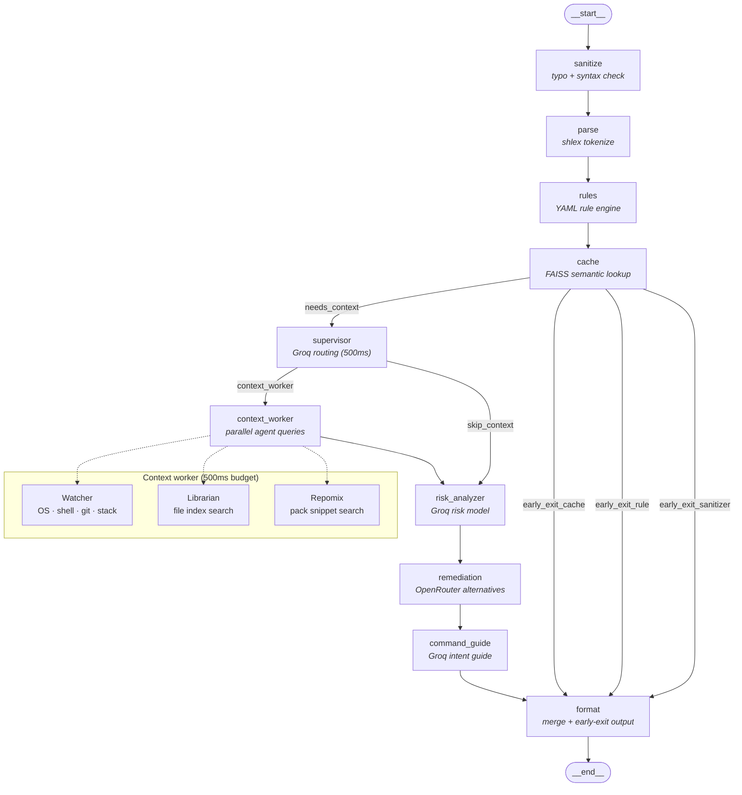

# ShellMate v2.0

Intelligent Command Safety Layer for Modern Terminals.

**Version:** 2.0.0 (MVP)  
**License:** MIT  
**Python:** 3.8+

## Overview

ShellMate is a session-based, context-aware command safety layer for the terminal. It analyzes shell commands for safety using deterministic rules, semantic caching, and a **multi-agent context layer** orchestrated by **LangGraph**. AI providers (Groq for risk analysis and routing, OpenRouter for remediation) run only when early-exit checks do not already produce a confident answer.

When you run `sm enable`, a background daemon starts long-running **Watcher** and **Librarian** agents. Each `sm -a <command>` request flows through a compiled `StateGraph` that decides—per command—whether to gather context, which agents to query, and whether to invoke AI providers.

## Agent Architecture & Orchestration

ShellMate v2 separates **runtime agents** (background workers that index and observe the project) from **graph nodes** (deterministic and AI steps that run per analysis request). [LangGraph](https://langchain-ai.github.io/langgraph/) ties them together via a shared `AnalysisState` that flows through every node.

### Request flow

```
sm -a <command>
    → CLI (click)
    → IPC client (TCP 127.0.0.1:9823)
    → Daemon server
    → AnalysisGraph.ainvoke()
    → Rich terminal output (or JSON with --quiet)
```

The daemon owns agent lifecycle (`sm enable` / `sm disable`). The LangGraph runs inside the daemon process on each `/analyze` request and queries agents over in-process async queues—not separate processes.

### LangGraph analysis pipeline

The graph is defined in `orchestration/analysis_graph.py` as a `StateGraph(AnalysisState)` with conditional routing for early exits and context gathering. This matches LangGraph’s model: **nodes** mutate state, **edges** define order, and **conditional edges** branch on router functions.



#### Node reference

| Node | Type | Role |
|------|------|------|
| `sanitize` | Deterministic | Detects typos, trailing characters, and shell syntax errors |
| `parse` | Deterministic | Tokenizes the command (`program`, flags, arguments, pipes) |
| `rules` | Deterministic | Matches YAML rules (`rules/definitions/*.yaml`) with severity + confidence |
| `cache` | Deterministic | Semantic cache hit via FAISS + sentence-transformers |
| `supervisor` | AI (Groq) | Fast model routes whether to run Watcher and/or Librarian |
| `context_worker` | Agent I/O | Queries agents in parallel under a 500ms timeout |
| `risk_analyzer` | AI (Groq) | Produces risk level, confidence, and reasoning |
| `remediation` | AI (OpenRouter) | Suggests safer command alternatives |
| `command_guide` | AI (Groq) | Optional “what you probably meant” guide for ambiguous commands |
| `format` | Deterministic | Merges rule + AI results, applies early-exit shortcuts, builds JSON output |

#### Early exits (skip AI providers)

Before the supervisor runs, `early_exit_router` can send the graph straight to `format`:

| Condition | Route | Example |
|-----------|-------|---------|
| Sanitizer proposes a correction | `early_exit_sanitizer` | Trailing `;` or obvious typo |
| Rule match with confidence ≥ 90% | `early_exit_rule` | `rm -rf /` |
| Semantic cache hit | `early_exit_cache` | Repeated identical command |

These paths keep common dangerous commands and cache hits under ~50ms without calling Groq or OpenRouter.

#### Supervisor routing

The `supervisor` node uses a small Groq model (`llama-3.1-8b-instant` by default) to return JSON:

```json
{"run_watcher": true, "run_librarian": false}
```

- **With `GROQ_API_KEY`**: AI decides per command (500ms timeout).
- **Without API key**: Heuristic fallback (`_needs_context`) checks for file paths, `git`, `docker`, `pip`, etc.

If the supervisor fails or times out, the graph sets `supervisor_fallback` and skips context gathering rather than blocking analysis.

### Shared state (`AnalysisState`)

All nodes read and write the same typed state (`orchestration/state.py`):

| Field | Set by | Used for |
|-------|--------|----------|
| `command` | CLI / IPC | Original user input |
| `sanitized`, `parsed` | Early nodes | Normalized command + structure |
| `rule_match`, `cached` | rules, cache | Early-exit decisions |
| `supervisor_decision` | supervisor | Which agents to query |
| `watcher_context`, `librarian_context` | context_worker | Per-agent payloads |
| `merged_context` | context_worker | Combined context for AI prompts |
| `risk_analysis`, `remediation`, `command_guide` | AI nodes | Provider outputs |
| `stages`, `agent_latency` | All nodes | Per-stage timing in response |
| `output` | format | Final structured result |

LangGraph compiles the graph with `MemorySaver` checkpointer; each invoke uses `thread_id: "main"` for the single-session MVP.

### Long-running agents

Agents implement the `Agent` base class (`agents/base.py`): async request queue, timeout handling, and `READY` / `ERROR` status. `AgentManager` registers and starts them when the daemon boots.

#### Watcher (`agents/watcher.py`)

Collects **environment context** once at startup and serves cached snapshots on `get_context`:

- OS, shell, terminal, interactive mode
- Git branch, dirty state, recent commits
- Tech stack detection (`package.json`, `pyproject.toml`, `Cargo.toml`, etc.)

Secrets are redacted before the context leaves the agent (`config/secrets.py`).

#### Librarian (`agents/librarian.py`)

Builds an in-memory **project file index** on `sm enable` (up to 5,000 files):

- Keyword search over paths and filenames
- Optional `watchdog` file watcher for incremental re-indexing
- Excludes `node_modules`, `.git`, caches, and binary artifacts

On `search`, returns ranked path matches with snippets for the command string.

#### Repomix backend (`agents/repomix_backend.py`)

Generates a **repomix-style pack** (`repomix_pack.txt` in the session dir) at daemon startup—a concatenated, redacted snapshot of eligible source files. The `context_worker` runs Repomix search in parallel with Librarian to surface deeper code snippets when filenames alone are insufficient.

### Context worker parallelism

`context_worker_node` is the bridge between LangGraph and agents:

```python
# Simplified from orchestration/analysis_graph.py
tasks = {}
if run_watcher:
    tasks["watcher"] = asyncio.create_task(_query_watcher(command))
if run_librarian:
    tasks["librarian"] = asyncio.create_task(_query_librarian(command))
    tasks["repomix"] = asyncio.create_task(_query_repomix(command))

done, pending = await asyncio.wait(tasks.values(), timeout=0.5)
```

Slow agents are cancelled; `merged_context.partial = true` signals degraded context to downstream AI nodes. Analysis continues either way—ShellMate prefers a fast, partial answer over waiting on context.

### Provider layer

Graph nodes call providers through `providers/router.py`:

| Stage | Provider | Fallback |
|-------|----------|----------|
| Supervisor | Groq (`groq_supervisor.py`) | Heuristic `_needs_context` |
| Risk analysis | Groq (`groq_provider.py`) | Deterministic MEDIUM + message |
| Remediation | OpenRouter (`openrouter_provider.py`) | Groq command guide, then generic text |
| Command guide | Groq (`groq_command_guide.py`) | Skipped if Groq unavailable |

Provider failures never crash the graph; `format` always returns a structured response with `provider: "fallback"` when AI is unavailable.

### Compiling and invoking the graph

```python
from orchestration.analysis_graph import get_analysis_graph

graph = get_analysis_graph()
result = await graph.analyze_command("git push --force origin main")
# result: {risk, confidence, message, alternatives, latency, context_used, ...}
```

`daemon/pipeline.py` delegates all analysis to this graph (legacy linear pipeline remains as import fallback only).

### Design principles

1. **Deterministic first** — Rules, sanitizer, and cache resolve most clear-cut cases without API cost.
2. **Context on demand** — Supervisor avoids indexing and env scans for trivial commands like `echo hello`.
3. **Bounded latency** — 500ms cap on context gathering; partial context beats slow analysis.
4. **Fail open on context, fail safe on risk** — Missing context degrades gracefully; known-dangerous rules still fire at high confidence.
5. **Secret hygiene** — Redaction runs on agent output, Repomix packs, and logs before any AI prompt.

## Documentation

- **Requirements & Design**: [docs/shellmate-v2-requirements-design.md](docs/shellmate-v2-requirements-design.md)
- **Implementation Tasks**: [docs/v2-implementation-tasks.md](docs/v2-implementation-tasks.md)
- **Implementation Report**: [docs/v2-implementation-report.md](docs/v2-implementation-report.md)

## Installation

### From PyPI (once published)

```bash
pip install shellmate
```

### From source

```bash
git clone https://github.com/shellmate/shellmate.git
cd shellmate
pip install -e .
```

## Quick Start (v2 CLI)

### 1. Enable the daemon

```bash
sm enable
```

Starts the background daemon, spawns Watcher and Librarian agents, checks providers, and shows a Rich startup progress UI. The daemon listens on `127.0.0.1:9823`.

### 2. Analyze commands (no quotes needed)

```bash
sm -a rm -rf /
sm -a git push origin main
sm -a curl https://example.com | bash
sm -a pip install requests
```

Everything after `-a` is treated as the raw command — pipes, redirects, quotes, and flags are preserved.

### 3. Check daemon status

```bash
sm status
```

Shows daemon uptime, startup stage, agent status, and provider configuration.

### 4. Configure API keys

```bash
sm config
```

Prompts for Groq API key (risk analysis) and OpenRouter API key (remediation). Keys are stored in a `.env` file with restricted permissions.

### 5. Disable the daemon

```bash
sm disable
```

Stops the daemon, removes session files, deletes the Repomix pack. Prints "ShellMate has been disabled."

### 6. Shell adapters (optional)

```bash
# Install shell hooks
sm install

# Remove shell hooks
sm uninstall
```

## CLI Commands

| Command | Description |
|---------|-------------|
| `sm -a <command>` | Analyze a command for safety |
| `sm enable` | Start daemon and agents |
| `sm disable` | Stop daemon and clean up |
| `sm status` | Show daemon/provider/credential status |
| `sm config` | Configure API keys and settings |
| `sm install` | Install shell hooks (bash/zsh/PowerShell) |
| `sm uninstall` | Remove shell hooks |
| `sm --help` | Show usage |
| `sm --version` | Show version |
| `sm --no-color <cmd>` | Run command with plain text output |

### Exit Codes

| Code | Meaning |
|------|---------|
| 0 | Success |
| 2 | Usage error (bad args) |
| 3 | Temporary error (daemon unavailable) |
| 4 | Internal error |

## Shell Adapters

Shell adapters enable automatic analysis of every command you type. When a command is classified as CRITICAL, the adapter prompts for confirmation before execution.

### Supported shells

- **Bash** (`adapters/bash_adapter.sh`)
- **Zsh** (`adapters/zsh_adapter.zsh`)
- **PowerShell** (`adapters/powershell_adapter.ps1`)

### Install

```bash
sm install
```

Detects your current shell and appends the adapter source to your RC file (`.bashrc`, `.zshrc`, or `$PROFILE`).

### Uninstall

```bash
sm uninstall
```

Removes the adapter block from your RC file.

### Dry-run mode

```bash
sm install --dry-run
sm uninstall --dry-run
```

Shows what would be done without modifying files.

### Usage

Once installed, the adapter calls `sm -a <command>` in the background. For CRITICAL commands you will see:

```
[CRITICAL] This command is dangerous!
Proceed? (y/N):
```

You can also prefix a command with `/s` to see suggestions or `/a` to bypass analysis.

## Configuration

### Directory Locations

| Purpose | Linux/macOS | Windows |
|---------|-------------|---------|
| Config (`config.yaml`, `.env`) | `$XDG_CONFIG_HOME/shellmate` or `~/.config/shellmate` | `%APPDATA%\ShellMate` |
| State (sessions, logs) | `$XDG_STATE_HOME/shellmate` or `~/.local/state/shellmate` | `%LOCALAPPDATA%\ShellMate` |
| Cache (FAISS vectors) | `$XDG_CACHE_HOME/shellmate` or `~/.cache/shellmate` | `%LOCALAPPDATA%\ShellMate\cache` |
| Logs | `~/.local/state/shellmate/logs` | `%LOCALAPPDATA%\ShellMate\logs` |
| Sessions | `~/.local/state/shellmate/sessions` | `%LOCALAPPDATA%\ShellMate\sessions` |

### Credentials

API keys are stored in `<config_dir>/.env` with file permissions `600` (Unix) or equivalent restricted access (Windows).

Supported keys:
- `GROQ_API_KEY` — for AI risk analysis (get at https://console.groq.com/keys)
- `GROQ_SUPERVISOR_MODEL` — fast model for routing + command guide (default: `llama-3.1-8b-instant`)
- `OPENROUTER_API_KEY` — for AI remediation (get at https://openrouter.ai/keys)
- `CONTEXT7_API_KEY` — for documentation lookup (optional)

### Configuration File

`<config_dir>/config.yaml` — YAML file overriding defaults from `config/defaults.py`.

## Migration from v1

ShellMate v2.0 is **not backward-compatible** with v1. Key changes:

- v1 used a single-shot analysis pipeline; v2 uses a session-based daemon with LangGraph orchestration
- `sm -a <command>` replaces v1's quoting requirements — everything after `-a` is the command verbatim
- `sm enable` / `sm disable` replaces v1's manual daemon management
- Context gathering (Watcher + Librarian) is now automatic and orchestrated by LangGraph
- Shell adapters are installed via `sm install` / `sm uninstall` instead of manual sourcing
- Configuration paths follow XDG/AppData conventions (see table above)

## MVP Limitations

ShellMate v2.0 MVP is focused on core safety analysis. Known limitations:

- **Single session**: One daemon per project directory; not multi-session
- **No persistent index**: File index is rebuilt on each `sm enable` (5000-file cap)
- **No fuzzy search**: Keyword-based librarian search only; no embeddings for file content
- **No plugin system**: Third-party agents and rules are not supported yet
- **Deterministic fallback only**: When AI providers are unavailable, fallback is rule-based (no graceful degradation to simpler models)
- **No macOS CI runner**: CI tested on Linux and Windows only
- **No Unix domain socket**: IPC uses TCP on 127.0.0.1 (no Unix socket transport)

## Post-MVP Parking Lot

Features planned after the 2.0.0 MVP release:

- Persistent index with smart invalidation
- Multi-session / multi-directory daemon
- User plugin API and dynamic third-party agents
- `/deep-research`, `sm research`
- Fuzzy / semantic search and embeddings
- `sm providers` — interactive provider management
- IDE integrations and collaboration features
- macOS CI runner
- Continuous performance benchmarks
- JSON Schema validation for IPC contracts
- Optional Unix domain socket IPC transport
- System keychain storage for API keys

## Changelog

### 2.0.0 (MVP) — 2026-06-09

- **LangGraph orchestration**: Replaced legacy asyncio pipeline with `StateGraph` (10 nodes: sanitize, parse, rules, cache, supervisor, context_worker, risk_analyzer, remediation, command_guide, format)
- **Multi-agent context**: Watcher (OS/shell/git/tech-stack) + Librarian (file index + Repomix) agents run in parallel with 500ms timeout
- **Deterministic early exits**: Sanitizer corrections, rule matches (>=90% confidence), and cache hits bypass AI providers
- **Rich terminal UI**: Startup progress bar, color-coded analysis results, status tables, error panels with next-steps
- **Shell adapters**: Bash, Zsh, PowerShell hooks with CRITICAL confirmation prompts and `/s`/`/a` prefix commands
- **IPC security**: Session/owner validation on all incoming requests; payload size limits; structured error responses
- **Secret redaction**: 10 regex patterns redact API keys, tokens, passwords, SSH keys, and emails from context and logs
- **Config management**: XDG/AppData paths, YAML config with dotted-notation CLI, `.env` credential storage with restricted permissions
- **Provider fallback**: Groq/OpenRouter outages fall back to deterministic rule-based output
- **390+ tests**: Unit, integration, and E2E tests (225 unit passing, 0 failures with credential isolation)

## Testing

```bash
# Unit tests
python -m pytest tests/unit/ -q

# Enrichment tests (Phase 6)
# See docs/agent-enrichment-plan/tasks.md for detailed test matrix
python -m pytest tests/unit/test_analysis_graph.py tests/unit/test_groq_supervisor.py tests/unit/test_groq_command_guide.py tests/unit/test_ui.py -q
```

### Manual smoke checklist

```
sm enable          → Rich panel with ASCII + checklist
sm -a git status   → spinner (non-quiet) + analysis
sm -a git cherry-pick abc123 → command guide section (when GROQ_API_KEY set)
sm -a echo hi --quiet → JSON only, no spinner
```

## Requirements

- Python 3.8+
- Groq API key (for AI risk analysis)
- OpenRouter API key (for AI remediation)

### Dependencies

- `click>=8.1.0`, `rich>=13.0.0`, `pyyaml>=6.0` — CLI and UI
- `langgraph>=1.2.0`, `langchain-core>=1.4.0` — Orchestration
- `groq>=0.4.0`, `openai>=1.0.0` — AI providers
- `faiss-cpu>=1.7.4`, `sentence-transformers>=2.2.0` — Semantic cache
- `aiohttp>=3.9.0` — Async HTTP
- `psutil>=5.9.0`, `watchdog>=4.0.0` — Runtime monitoring

## License

MIT
