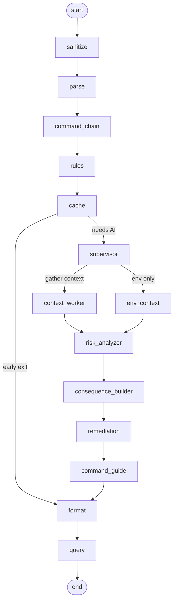

# ShellMate

**A friendly safety net for your terminal.**

[](https://pypi.org/project/shellmate-cli/)
[](https://pypi.org/project/shellmate-cli/)
[](LICENSE)

The terminal is powerful — and a little scary when you're starting out. One wrong
command can delete files, wipe a branch, or break something you didn't mean to touch.

ShellMate is like having an experienced friend looking over your shoulder. As you
type, it quietly checks your command and, **before you press Enter**, tells you in
plain English what it will do, whether it's risky, and if there's a safer way. It
never runs anything for you — **you're always the one in control.**

```text
$ rm -rf /
[!!] BLOCKING — this would erase everything. Press Enter again only if you're sure.

$ git push --force
→ This rewrites history on the remote branch (others may lose work).
→ Reversible: No   |   target: origin/main
→ Safer option:   git push --force-with-lease
```

---

## Why you'll like it

- **Stops the scary stuff.** Genuinely dangerous commands (like `rm -rf /`) are
  caught instantly and ask you to confirm before they run.
- **Explains commands in plain English.** No more guessing what a command does —
  ShellMate tells you what will happen and whether you can undo it.
- **Suggests safer alternatives.** When there's a gentler way to do the same thing,
  it offers it.
- **Autocomplete that helps you learn.** Press Tab for suggestions as you type.
- **Stays out of your way.** Safe commands run normally — no pop-ups, no nagging.
- **You stay in control.** ShellMate only *shows* you things. It never executes
  commands on its own.

---

## Get started in 3 steps

### 1. Install it

```bash
pip install shellmate-cli
```

### 2. Give it a brain (a free API key)

ShellMate uses an AI service to explain commands. The easiest free option is **Groq**:

1. Grab a free key at **[console.groq.com](https://console.groq.com)** (takes a minute).
2. Tell ShellMate about it:

   ```bash
   sm config
   ```

   It'll ask you to pick a provider and paste your key. That's it — the key is
   stored privately on your computer, not in your command history.

### 3. Turn it on

```bash
sm install    # connects ShellMate to your shell (one time)
sm enable     # starts the helper in the background
```

Now just **use your terminal normally.** Little notes will appear under your
commands as you type.

> **What you need:** Python 3.10+, and either **Windows PowerShell** or, on
> **Linux/WSL**, [ble.sh](https://github.com/akinomyoga/ble.sh). ShellMate sets up
> the rest for you.

---

## What it feels like to use

As you type, ShellMate shows a tiny note under your command:

| You type | You see | What it means |
|----------|---------|---------------|
| `ls` | *(nothing)* | Totally safe — ShellMate stays quiet. |
| `git push --force` | `[!] rewrites history [PROD]` | Heads up: this is risky and you're on production. |
| `rm -rf /` | `[!!] BLOCKING — Enter again to confirm` | Dangerous. It won't run until you really mean it. |

**Dangerous commands don't run on the first Enter.** You'll get a clear warning, and
only a *second* Enter actually runs them — a gentle "are you sure?" that has saved
many people from a bad day.

**Want to understand a command?** Press **Tab** for a suggestion, and a short
"here's what this will do" preview appears before you commit to it.

---

## Everyday commands

These are the only commands you need day to day:

| Command | What it does |
|---------|--------------|
| `sm enable` | Turn ShellMate on. |
| `sm disable` | Turn it off. |
| `sm status` | Check if it's running and healthy. |
| `sm config` | Set or update your API key. |
| `sm uninstall` | Remove ShellMate from your shell (keeps your settings). |
| `sm --help` | See everything. |

---

## A note on your privacy

Being honest about how it works:

- The **instant danger checks** (like catching `rm -rf /`) run **entirely on your
  computer** — no internet needed.
- When ShellMate needs AI help to explain a trickier command, the **command text you
  typed** is sent to the AI provider you chose (e.g. Groq) so it can analyze it.
- Your API key is stored locally in a private config file, never in your shell history.
- As with any tool that talks to a cloud service, **avoid typing passwords or secret
  keys directly on the command line.**

---

## Troubleshooting

- **"I don't see any notes."** Run `sm status` to confirm the daemon is running, and
  make sure you ran `sm enable`. On a brand-new install, open a fresh terminal so the
  shell hook loads.
- **"It says my AI model isn't available."** Some free accounts can't use every model.
  ShellMate will warn you at startup and `sm status` lists the models your key *can*
  use — set one with `sm config`.
- **"Is it slowing me down?"** Safe commands get an instant local check (under 10ms).
  Only genuinely unclear commands ever wait on the AI.

---

<details>
<summary><b>Under the hood</b> (for the curious / power users)</summary>

### How it works

```
You type in the shell
    → ble.sh (Linux/WSL) or PSReadLine (Windows) adapter
    → IPC to a background daemon (TCP 127.0.0.1:9823)
    → LangGraph analysis pipeline
    → Inline annotation / confirmation gate
```

Three tiers, fastest first:

1. **Instant catastrophic check** — local YAML rules (`shellmate/rules/catastrophic.yaml`), no API, <10ms.
2. **Debounced partial analysis** — ~300ms after you pause typing (`/analyze-partial`).
3. **Full analysis** — rules → exact-match cache → AI + context agents when risk is unclear.

### Install from source

```bash
git clone https://github.com/sayan-does/shellmate.git
cd shellmate
pip install -e ".[dev]"
python -m build
```

### Annotation badges

| Kind | Examples |
|------|----------|
| Risk | `[OK]` `[i]` `[!]` `[!!]` `[X]` |
| Environment | `[PROD]` `[STAGE]` `[DEV]` `[CI]` |
| Time | `BH` (business hours) · `AH` (after hours) |
| Chain / consequence | `[BROKEN]` `[ESCALATION]` `[IRREVERSIBLE]` |

### Bracket syntax (typed inline; adapters strip and honor them)

| Syntax | Purpose | Example |
|--------|---------|---------|
| `[?…]` | Ask a question about the command | `docker rm $(docker ps -aq) [?why dangerous]` |
| `[!…]` | Directive to the analyzer | `rm -rf /tmp [!force]` |
| `[@key=value]` | Override context | `git reset --hard [@env=production]` |

### Full CLI

| Command | Description |
|---------|-------------|
| `sm install` | Install shell hooks (bash/zsh → ble adapter, PowerShell → PS adapter) |
| `sm uninstall` | Remove shell hooks (keeps config) |
| `sm config` | Configure API keys and settings |
| `sm enable` | Start daemon (autocomplete mode) |
| `sm disable` | Stop daemon and clean session |
| `sm status` | Daemon, agents, providers, credentials |
| `sm --help` / `sm --version` | Help / version |
| `sm --no-color <cmd>` | Plain-text output |

```bash
sm install --dry-run             # preview changes without touching files
sm config --show                 # masked credentials
sm config provider risk_analysis xai grok-3-mini   # set a provider role
sm config cache.max_entries 200  # YAML override (dotted key)
```

Exit codes: `0` success · `2` usage error · `3` temporary error · `4` internal error.

### Analysis pipeline

Defined in `shellmate/orchestration/analysis_graph.py` (LangGraph `StateGraph`):



**Early exits** (skip AI): sanitizer correction, high-confidence rule match, cache hit.

### Daemon agents (started by `sm enable`)

| Agent | Purpose |
|-------|---------|
| Watcher | OS, shell, git, tech-stack snapshot |
| Librarian | Project file index + search |
| Environment | Environment / staging signals |
| CommandChain | Chain-pattern analysis |
| Query | Answers `[?…]` queries |

### Providers

| Stage | Default | Fallback |
|-------|---------|----------|
| Supervisor / risk / guide | Groq | Grok (xAI) / heuristic |
| Remediation | OpenRouter | Grok (xAI) / Groq guide / generic text |

Configure **at least one** of Groq, OpenRouter, or Grok (xAI). Instant catastrophic
gating always uses local rules, with or without a key.

### Where things live

| Purpose | Linux / macOS | Windows |
|---------|---------------|---------|
| Config + `.env` | `~/.config/shellmate` | `%APPDATA%\ShellMate` |
| State / sessions / logs | `~/.local/state/shellmate` | `%LOCALAPPDATA%\ShellMate` |
| Cache | `~/.cache/shellmate` | `%LOCALAPPDATA%\ShellMate\cache` |
| Installed adapters | `~/.shellmate/adapters/` | `%USERPROFILE%\.shellmate\adapters\` |

### Environment variables

| Variable | Required | Purpose |
|----------|----------|---------|
| `GROQ_API_KEY` | one of the three | Risk analysis, supervisor, command guide |
| `OPENROUTER_API_KEY` | one of the three | Remediation alternatives |
| `XAI_API_KEY` | one of the three | Risk + remediation via Grok |
| `CONTEXT7_API_KEY` | no | Optional docs lookup |
| `GROQ_SUPERVISOR_MODEL` | no | Override supervisor model (default `qwen/qwen3.8-27b`) |
| `XAI_MODEL` | no | Override Grok model (default `grok-3-mini`) |

Optional YAML overrides live in `<config_dir>/config.yaml`.

### Dependencies (authoritative: `pyproject.toml`)

`click`, `rich`, `pyyaml` (CLI/UI) · `langgraph`, `langchain-core` (orchestration) ·
`groq`, `openai`, `aiohttp` (providers) · `psutil`, `watchdog` (runtime) · `numpy`.

CI builds and smoke-tests the wheel on Python 3.10–3.12. Publishing runs on `v*` tags
via Trusted Publishing (`.github/workflows/publish.yml`).

</details>

---

Made to make the terminal a little less scary. **MIT licensed** — contributions welcome at
[github.com/sayan-does/shellmate](https://github.com/sayan-does/shellmate).
